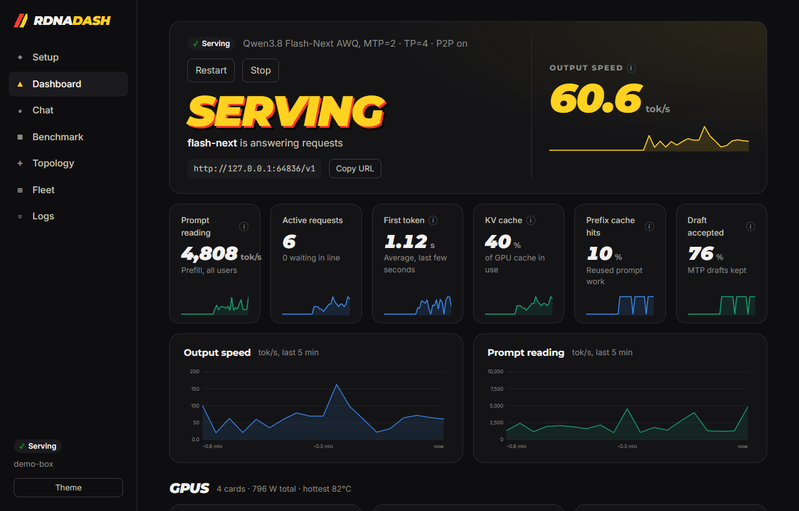
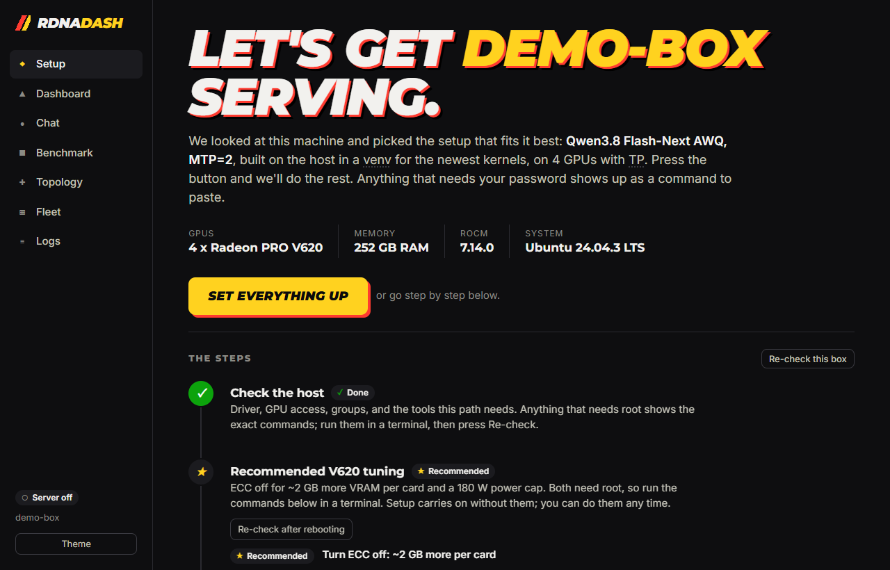
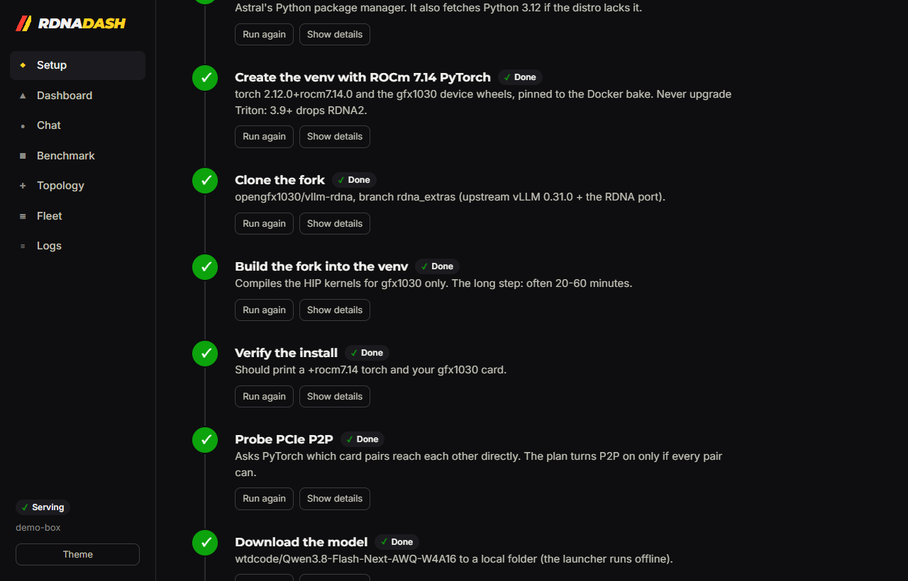
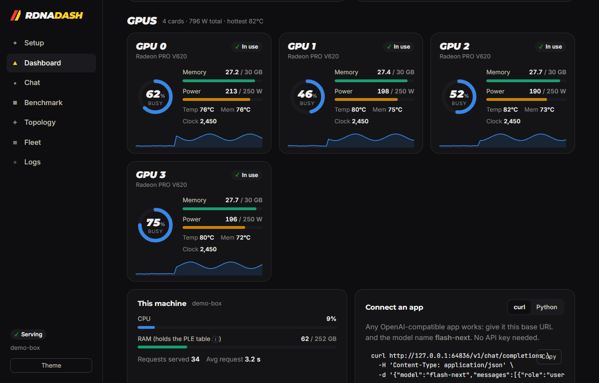
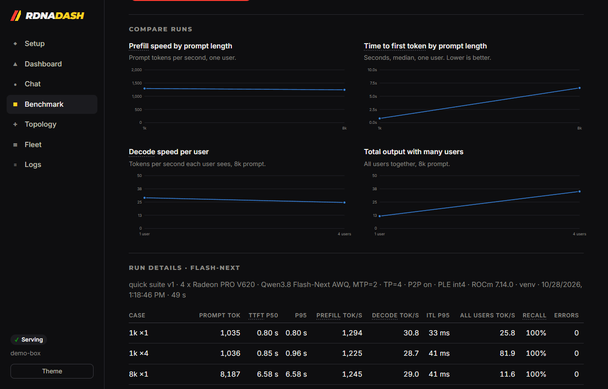
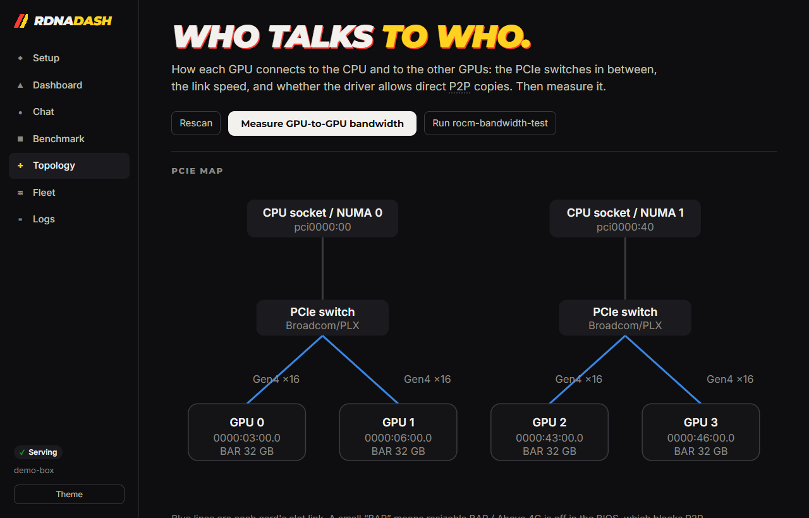
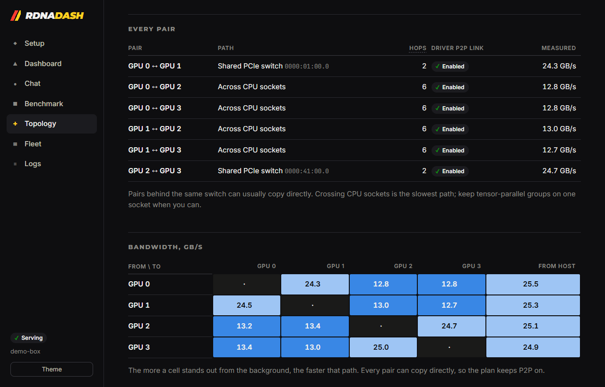
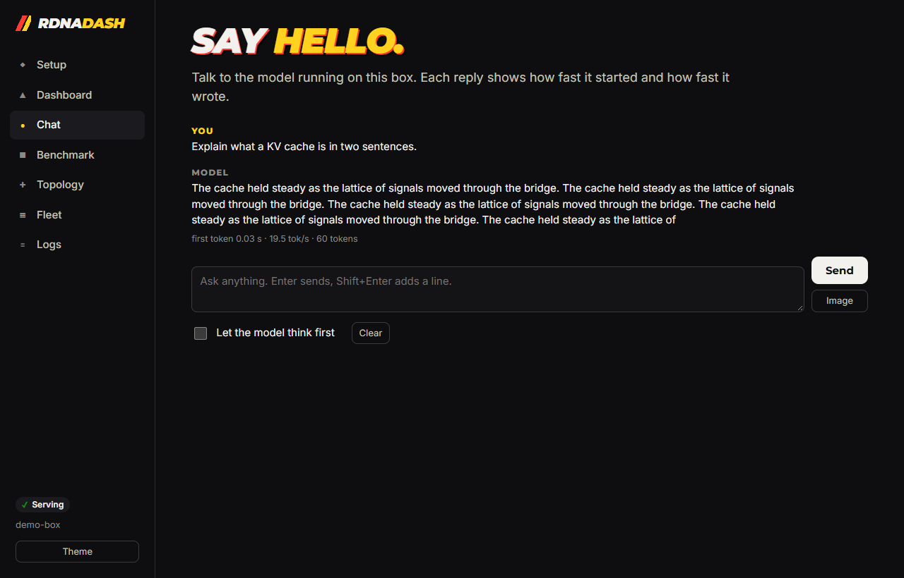
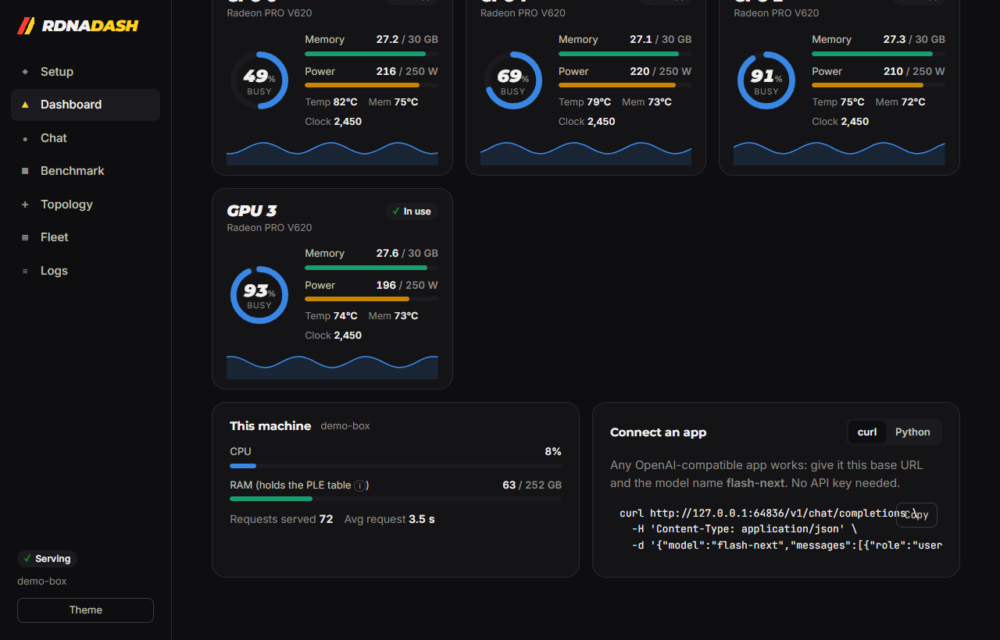
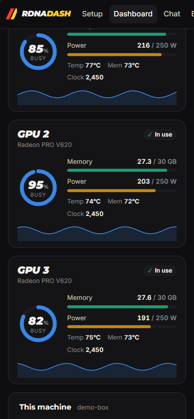

# vllm-rdna-dash

**Install, tune, benchmark and watch [vllm-rdna](https://github.com/opengfx1030/vllm-rdna) on AMD RDNA2 (gfx1030) GPUs, from one page.**

Install the tool, open it, press **Set everything up**, and chat with a model. It looks at your machine, picks the recipe that fits, runs the install steps it can, shows you the commands for the ones that need root, starts the server, and turns into a live dashboard.

Built for the [gfx1030 community](https://blivioniag.github.io/gfx1030-wiki/): Radeon PRO V620 and W6800 first, RX 6800/6900 and the RDNA2 cousins (via `HSA_OVERRIDE_GFX_VERSION`) too.

<p align="center"></p>

## Quick start

On the GPU box (Linux with Docker and the ROCm driver), start the published image with no install script:

```bash
docker run -d --name vllm-rdna-dash --restart unless-stopped --network host \
  --device /dev/kfd --device /dev/dri --security-opt label=disable \
  -v /var/run/docker.sock:/var/run/docker.sock \
  -v /srv/vllm-rdna:/srv/vllm-rdna \
  -v /etc/os-release:/host/etc/os-release:ro \
  ghcr.io/crispyging/vllm-rdna-dash:latest
```

Open `http://your-gpu-box:7860` (your box's name or IP) from any computer on your network. There's no login to set up. Models, caches, settings and benchmark results live in `/srv/vllm-rdna`.

**What each line gives it:**
- `--network host`: the dashboard answers on port 7860 and reaches the model server on localhost.
- `--device`: it can read the GPUs.
- `docker.sock`: it can start the vLLM container. This is root-equivalent on the host (see [Security](#security)).
- `/srv/vllm-rdna`: its data folder, the same path inside and outside the container.
- `os-release`: it can name your distro when it suggests a fix.

To update:

```bash
docker pull ghcr.io/crispyging/vllm-rdna-dash:latest
docker rm -f vllm-rdna-dash
```

Then run the `docker run` line again. Your data stays in `/srv/vllm-rdna`.

### With Docker Compose

Compose is easier if you want to change settings. [`compose.yml`](compose.yml) is the same setup as the line above. Download it and read it first if you like:

```bash
mkdir vllm-rdna && cd vllm-rdna
curl -fsSLO https://raw.githubusercontent.com/crispyging/vllm-rdna-dash/main/compose.yml
docker compose up -d
```

To update, run `docker compose pull && docker compose up -d` in that folder. Tools such as Arcane, Portainer and Dockge can run the same file. Point their compose path at `compose.yml`, not `docker-compose.yml`.

Every setting is optional. Put them in a `.env` next to `compose.yml`, or in your tool's environment settings:

| Variable | What to put |
|---|---|
| `RDNA_DASH_TOKEN` | A long random string to require a login. Empty (the default) means no login |
| `DATA` | Folder for models, caches and settings. Default `/srv/vllm-rdna` |
| `PORT` | Dashboard port. Default `7860` |
| `MODELS_DIR` | A folder of models outside `DATA`. Also add it under `volumes`, same path on both sides |
| `VIDEO_GID`, `RENDER_GID` | Host group IDs of the GPU devices, as bare numbers. Only needed if the dashboard says it cannot open `/dev/kfd`, and it prints the values to use |

With `RDNA_DASH_TOKEN` empty, anyone who can reach the port can use the dashboard, and the dashboard can start containers through the Docker socket. Set a token unless the network is yours alone.

### Install script

[`install.sh`](install.sh) is optional. It does the Compose steps for you in `~/vllm-rdna`, and it is the easy way on rootless Podman, which needs its own socket path and `group_add: [keep-groups]`. Read it first if you use it:

```bash
curl -fsSL https://raw.githubusercontent.com/crispyging/vllm-rdna-dash/main/install.sh -o install.sh
less install.sh
sh install.sh
```

Run it again to update.

**Without containers:** `install-host.sh` installs the tool directly on the host (Python 3.8+ and git), which is also the only way to build the fork in a host venv:

```bash
curl -fsSL https://raw.githubusercontent.com/crispyging/vllm-rdna-dash/main/install-host.sh | sh -s -- --start
```

**Just looking?** `python -m rdna_dash --demo` runs the whole UI against a pretend 4 × V620 box and a fake model server. It installs nothing.

**No browser handy?** `docker exec vllm-rdna-dash python -m rdna_dash doctor` (or `rdna-dash doctor` on a host install) prints the same checks in the terminal.

## Screenshots

Taken in demo mode (`python -m rdna_dash --demo`): a pretend 4 × V620 box with a fake model server, so the numbers are illustrative.

| | |
|---|---|
|  |  |
| **Setup.** What the box has, the plan, and one button. | **One click later.** Every step done, with logs a click away. |
|  |  |
| **GPUs.** Busy, memory, power against the cap, temperatures and clocks. | **Benchmark.** Prefill, first token, decode and recall, saved and compared. |
|  |  |
| **Topology.** How each card reaches the CPU and the others. | **Bandwidth.** Measured GB/s for every pair. |
|  |  |
| **Chat.** First-token time and tok/s on every reply. | **Light mode.** |

<p align="center"></p>

## What it does

**Setup.** A read-only profile of the box covers:
- GPUs (PCI id, gfx target, VRAM, ECC counters, power cap)
- ROCm installs (`/opt/rocm`, TheRock `core-*`, or distro ROCm under `/usr`)
- `video`/`render` groups and `/dev/kfd`
- Docker or Podman (rootless too) and compose
- package manager, SELinux, virtualization, CPU vendor, RAM and disk

Every finding comes as a plain sentence, the fix for your package manager, and a wiki link. Steps that need root are never run for you; they show up as commands to paste. Everything else (uv, the ROCm 7.14 PyTorch venv, cloning and building the fork, the model download, the P2P probe, the dry run, compose.yml, the start-up and a first request) runs from one button or one step at a time, with live logs.

**Model downloads.** A built-in downloader fetches the model (and the Flash-Next PLE table) into `models/` in the data folder, which is the folder the server reads. It shows a progress bar with speed and time left, resumes an interrupted download, and skips files that are already complete. Set **Max download speed** on the step (MB/s); you can change it while a download is running and it applies within a second. Gated models need `HF_TOKEN`.

**Tuning per box.** The plan picks:
- the recipe
- container or host venv
- TP or PP and which GPUs (`HIP_VISIBLE_DEVICES`)
- P2P on or off: measured when possible; off in VMs; A/B on Intel
- the PLE mode for Flash-Next, based on RAM
- `HSA_OVERRIDE_GFX_VERSION` for cousin cards
- the port, and whether to bind to localhost or the LAN

It warns about the ROCm 7.2.1-7.13 multi-GPU RCCL range. Every setting shows why it was chosen. "Change" lets you override any of it.

**Dashboard.** Server state in words (Serving / Starting: compiling / Stopped with an error), plus:
- output and prompt tok/s
- running and waiting requests
- KV cache use, TTFT, prefix-cache hits, MTP draft acceptance
- per-GPU busy %, VRAM, edge/junction/memory temperatures, power against the cap, and clocks
- host CPU and RAM

A log doctor matches known vLLM-on-RDNA failures (no GPU access, missing gfx1030 wheels, RCCL, `rdna_ar` hangs, OOM, offline model, stale Inductor cache, TunableOp mismatch and more) and links each one to its fix.

**Chat.** Streams from the local server, shows first-token time and tok/s per reply, and supports image input for vision models.

**Benchmark.** The same test for every model, so runs compare:
- Prompts come from a seeded corpus, sized to exact token counts with the server's own `/tokenize`.
- A unique salt on every request keeps the prefix cache from flattering a run.
- Output is fixed with `ignore_eos` at temperature 0.
- Contexts run from 1k to 128k, at 1/4/8 concurrent users.
- Vision cases use generated images and are skipped on text-only models.
- A hidden passkey at 50% depth checks that long context actually works.

It reports TTFT p50/p95, prefill tok/s, per-user decode tok/s, inter-token latency, aggregate output and recall. Each run is saved with a fingerprint (box, recipe, TP/PP, P2P, PLE, ROCm) and can be compared with others. The CLI version: `rdna-dash bench http://host:port/v1 --suite standard`.

**Topology.** Draws each GPU's PCIe path (root port, PLX/Broadcom switches, the on-card bridge), its link gen and width, NUMA node and BAR size. For every pair it shows the path type, hop count, and whether the driver created a KFD P2P link. "Measure" runs a PyTorch peer-copy test (in the venv or the image), drawn as a heatmap; the result feeds the P2P setting. The **P2P for vLLM** panel has an Auto / On / Off switch for whether vLLM uses direct GPU-to-GPU copies, plus a checklist of what the driver needs before it can: P2P links in the KFD topology, large BAR, `iommu=pt`, CPU platform, bare metal. When driver P2P is off it links the wiki and v620_toolbox `pcie_p2p` steps; that part is kernel and BIOS work the dashboard can't do for you. If `rocm-bandwidth-test` is installed it runs that too, and raw `amd-smi topology` output is one click away.

**Recommended V620 tuning: ECC off and a 180 W cap.** Both are recommended by default and shown as a setup step right after the host check. They need root and reboots, so setup carries on without them.

The 180 W cap keeps the cards much cooler and quieter, with little speed loss on memory-bound inference:

```bash
curl -fsSL https://raw.githubusercontent.com/crispyging/vllm-rdna-dash/main/tools/power.sh | sudo bash -s -- 180 --persist
#   ... | sudo bash -s -- status     show caps
#   ... | sudo bash -s -- --remove   back to stock on the next reboot
```

When the driver enforces the 250 W VBIOS floor, the dashboard and the script point you to the [v620_toolbox](https://github.com/blivioniag/v620_toolbox) powerfix first.

For ECC, the dashboard shows whether it's on, half-way through the two-reboot switch, or off. It never recommends turning it off when a card already reports ECC errors. The script does the bootloader work:

```bash
curl -fsSL https://raw.githubusercontent.com/crispyging/vllm-rdna-dash/main/tools/ecc.sh | sudo bash -s -- off
#   then reboot twice. "status" shows where you are, "on" undoes it.
```

It handles grubby (Fedora/RHEL), update-grub / grub-mkconfig (Debian/Ubuntu/Arch/openSUSE), kernelstub (Pop!_OS) and systemd-boot `/etc/kernel/cmdline`, and backs up what it edits.

**Fleet.** Add your other boxes (dashboard URL, plus their token if they require a login) and see them side by side. Box names and addresses stay in your local config, never in this repo.

## Recipes

A recipe is one JSON file: model, requirements, and how to launch it in a container and/or with the fork's launcher. Built-ins live in [`recipes/`](recipes/). The tool also loads:

1. `~/.config/vllm-rdna-dash/recipes/*.json` (your own)
2. every folder in `RDNA_DASH_RECIPES` (separated by `:`), for example a team repo checkout

A later file with the same `id` overrides an earlier one. Broken files are listed in the UI, not silently dropped.

```json
{
  "id": "my-model-tp2",
  "label": "My model on two cards",
  "summary": "One line shown in the plan.",
  "priority": 15,
  "layout": "tp",
  "model": { "repo": "org/model-AWQ", "dir": "model-AWQ", "revision": "main" },
  "requires": { "gfx": ["gfx1030"], "cards": [2], "min_vram_per_card_gb": 28, "min_ram_gb": 32 },
  "prefer": "container",
  "container": { "served_name": "my-model", "max_len": 16384, "args": ["--trust-remote-code"] },
  "venv": { "recipe": "27b-awq", "served_name": "q27d", "port": 18210 }
}
```

`venv.recipe` names a launcher recipe in the fork's `tools/rdna/recipes/`. The tuner keeps the recipes that fit the box, prefers ones whose install path works here, and then takes the highest `priority`.

## Running the container by hand

[`examples/vllm-compose.yml`](examples/vllm-compose.yml) plus [`examples/vllm.env.example`](examples/vllm.env.example) run vLLM itself without the dashboard. They work with `docker compose`, `podman compose` and `podman-compose`. It uses `label=disable` for SELinux hosts and documents the `keep-groups` change for rootless Podman. The dashboard writes its own tuned version to `vllm-compose.yml` in its data folder.

## Security

- **No login by default.** The container install listens on your network (port 7860), and anyone who can reach that port can use it. The dashboard shows a warning saying so. A host install binds to `127.0.0.1` unless you pass `--host 0.0.0.0`.
- The dashboard container mounts the Docker socket so it can run the vLLM container. That is root-equivalent on the host, so only run it without a login on a network you trust.
- **To require a login**, set `RDNA_DASH_TOKEN` to a long random string: add `-e RDNA_DASH_TOKEN=...` to `docker run`, or put it in the `.env` next to `compose.yml` and run `docker compose up -d`. You then sign in once per browser; fleet peers send it as `Authorization: Bearer`.
- Either way, websites you visit can't drive it: POSTs need a custom header a cross-site page cannot send, and without a login it only answers to IP addresses and local names (`gpu-box`, `gpu-box.local`, `.lan`), which blocks DNS-rebinding pages. Use another name by listing it in `RDNA_DASH_ALLOWED_HOSTS`.
- The model server (the OpenAI-compatible endpoint) listens on your network in a container install, so other machines can use it at `http://your-gpu-box:8000/v1`; the dashboard shows the address you reached it with. A host install keeps it on localhost until you press **Share on my network**. vLLM itself has no login, so anyone on the network can send it requests.
- Install scripts come from the plan, never from the browser, and never use sudo.
- `rdna-dash share` and "Copy redacted report" strip the hostname, username and tokens.

## Layout

```
rdna_dash/
  profile.py    read-only system profile (sysfs, /proc, rocminfo, containers)
  tuning.py     recipes + profile -> checks, settings, steps, launch, compose
  topology.py   PCIe / KFD topology and the peer-copy benchmark
  bench.py      the consistent benchmark (also usable as a library)
  telemetry.py  1 Hz GPU / host / vLLM metrics sampler
  logdoctor.py  known-failure rules
  jobs.py serve.py server.py   step runner, server lifecycle, HTTP API
  demo.py       pretend box + fake vLLM server
  web/          the UI (no build step, no CDN scripts)
recipes/        built-in recipes
compose.yml     the dashboard container
Dockerfile      its image, published to ghcr.io/crispyging/vllm-rdna-dash
examples/       vLLM by hand with compose, no dashboard
tools/ecc.sh    ECC on/off/status
tools/power.sh  V620 power cap (180 W default), optional boot unit
```

Stdlib only. Tests: `python -m unittest discover -s tests`.

## Status

The tuner, benchmark, log doctor and UI are tested in demo mode, and the profiler and `doctor` run on Linux. Not yet verified end to end on real gfx1030 hardware: the first real runs on V620 boxes should check the install steps, the PCIe/KFD parsing and the bandwidth test. Please open an issue with `rdna-dash share` output when something is off.

Model choices and tuning rules follow the [gfx1030 wiki](https://blivioniag.github.io/gfx1030-wiki/) and the fork's README and recipes.
